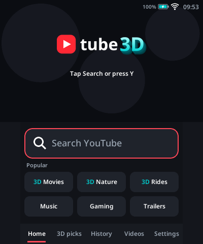
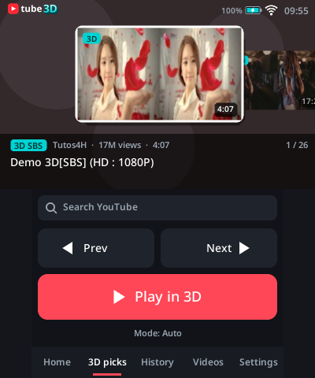
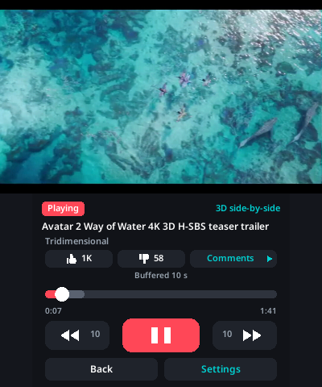
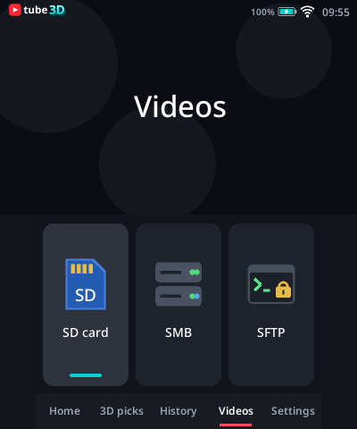
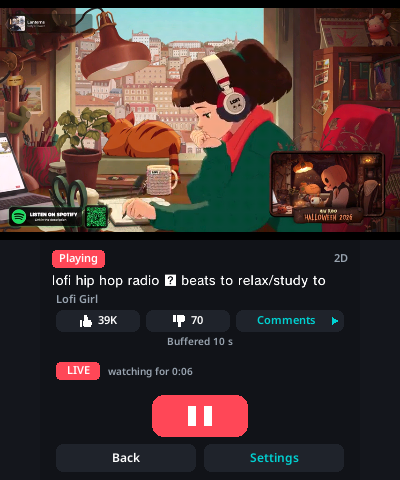
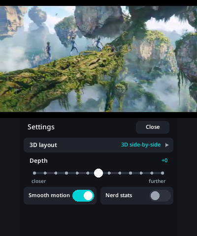
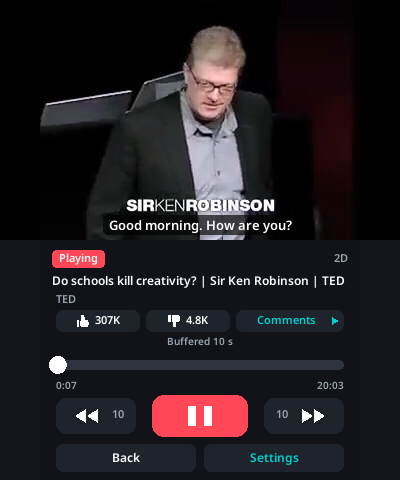
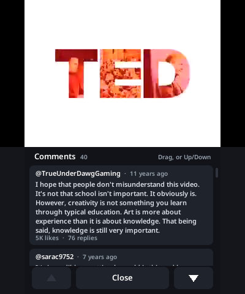
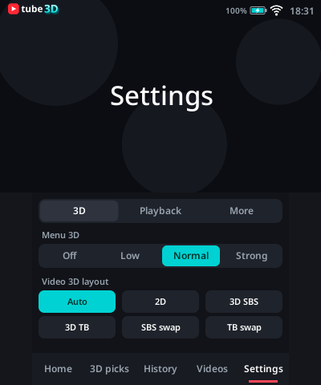

<h1 align="center">
  <picture>
    <source media="(prefers-color-scheme: dark)" srcset="docs/logo-dark.png">
    
  </picture>
</h1>

**Watch YouTube and your own videos on 3DS, in real stereoscopic 3D.**

Tube3D is a homebrew video player for the **3DS**. It plays
YouTube videos, plays files from the SD card or from SMB and SFTP shares,
and shows side-by-side and top-bottom 3D videos with real depth on the top screen.

Also features **Smooth motion**, so videos move as fluidly as the 3DS's 60 Hz screen allows.

> **For now Tube3D needs a New 3DS, New 3DS XL or New 2DS XL.** Support for the original 3DS,
> 3DS XL and 2DS is planned for the next version.

<p align="center">
  
  
  
</p>
<p align="center"><sub>Screenshots taken on a New 3DS: the top screen (left eye) above the touch screen.</sub></p>

## Features

**YouTube**
- Search with results that keep loading as you scroll, quick picks (3D Movies, Nature, Rides,
  Music, Gaming, Trailers) and a **3D picks** tab. A YouTube link typed into the search bar
  plays that video.
- **480p for the whole video**, with automatic fallback to 360p.
- **Live streams** (a red LIVE mark and how many are watching), played a few seconds behind live.
- **Subtitles**: the uploader's tracks and auto-generated ones.
- **Comments** (read-only), view counts, and like and dislike counts on the player.
- History of the videos you watched.

**Your own videos**
- Browse the **SD card**, **SMB** shares (Windows / Samba / NAS) and **SFTP** servers like a file
  manager. MKV and MP4 with H.264 video play up to **1080p**. Each file shows a frame preview,
  its length, resolution and size.
- Audio tracks (AAC, AC-3, E-AC-3, DTS, MP3, Opus, Vorbis, FLAC) and subtitles - text tracks
  inside the file or `.srt` / `.vtt` files beside it.

**Smooth motion**
- Adds in-between pictures while the video plays, so it moves at the screen's 60 Hz instead of 24 or 30
frames a second. Pans and fast scenes stop juddering.
- Works for YouTube, files and live streams, and in 3D: both eyes follow the same motion, so the
  depth stays steady.
- Scene cuts stay sharp, and 24 or 25 fps films that were uploaded at 30 fps lose their doubled
  frames, so they move evenly again.
- On by default (Settings → Playback → Motion). When a video is too heavy to keep up, it falls
  back to plain frames by itself.

**3D and playback**
- Stereoscopic 3D for side-by-side and top-bottom videos (half or full, eyes swapped too).
  YouTube rarely marks 3D videos, so Tube3D also **detects the layout from the picture**.
- **Auto-convergence** keeps the depth comfortable; Up/Down or the depth slider adjusts it.
- Hardware H.264 decoding with frame pacing locked to the audio.
- Optional *Nerd stats*: resolution, frame rate, buffer and decoder figures over the video.

<p align="center">
  
  
  
</p>
<p align="center">
  
  
  
</p>

## Requirements

- A **New** 3DS, New 3DS XL or New 2DS XL (the hardware H.264 decoder exists only on the New
  models) with custom firmware ([Luma3DS](https://github.com/LumaTeam/Luma3DS)). The original
  3DS, 3DS XL and 2DS are coming in the next version.
- **Dumped DSP firmware**, or there is no sound: Rosalina menu (L + D-pad Down + Select) →
  Miscellaneous options → Dump DSP firmware.
- Wi-Fi with internet access (for YouTube).

## Install

Download `Tube3D.cia` or `Tube3D.3dsx` from the Releases page, or build them (below).

- **CIA:** make a QR code of the `Tube3D.cia` link on the
  Releases page (any QR generator), then on the 3DS open **FBI → Remote Install → Scan QR Code**
  and scan it. Copying the CIA to the SD card and installing it from FBI works too.
- **3DSX:** copy `Tube3D.3dsx` to `sdmc:/3ds/` and start it from the Homebrew Launcher.

Settings, history, saved places and resume points are kept in `sdmc:/3ds/Tube3D/`. Your own
videos can be anywhere on the SD card (for example `sdmc:/videos/`).

## Controls

Everything works by touch. With buttons:

| Browsing | |
|---|---|
| D-pad / Circle Pad | Move through the list |
| A | Play / open |
| Y | Search (words or a YouTube link) |
| X | Videos tab, on a saved place: edit or remove it |
| L / R | Previous / next tab |
| B | Back (up a folder in Videos, else Home) |
| SELECT | Playback mode (Auto, 2D, SBS, TB, swapped) |
| START | Exit |

| Playing | |
|---|---|
| A | Pause / resume |
| B | Back to the menu |
| D-pad Left / Right | −10 s / +10 s |
| L / R | −60 s / +60 s |
| D-pad Up / Down | 3D depth closer / further |
| X | Switch the 3D layout |
| Y | Subtitles and audio tracks |
| SELECT (or the Comments button) | Comments |
| START (or Settings) | Player settings: subtitles, 3D layout, depth, Smooth motion, nerd stats |
| Tap / drag the progress bar | Jump to that point |
| HOME | HOME Menu; coming back continues where you were |
| 3D slider | Up = 3D, down = flat |

**Finding 3D videos:** open **3D picks** or a 3D quick pick, or search for things like
`3D SBS trailer`. If a video still looks wrong, press X while it plays. Cross-eyed ("crossview")
videos need the *swapped* layouts.

## Troubleshooting

| Symptom | Fix |
|---|---|
| Video plays, no sound | Dump the DSP firmware (see Requirements). |
| "No internet connection" | Settings → More → Wi-Fi test shows what fails. |
| Videos look soft (360p) | YouTube may have closed the 480p route Tube3D uses; check for an update or kindly make an issue. |
| "Sign in to confirm you're not a bot" | YouTube refuses requests from your network for now; try later or another network. |
| "Can't play this video" | Age-restricted, members-only and paid videos don't play. |
| "Can't connect to &lt;place&gt;" | Check the address, port, user and password (⋮ → Edit) and that the PC / NAS is on. |
| 3D looks inside-out | Press X until you reach the *eyes swapped* layout. |
| Picture is two squashed halves | The video is 3D but wasn't detected: press X to pick SBS or TB. |
| Some titles show boxes | The 3DS system font doesn't have every script. |

## Build

1. Install devkitPro with the 3DS tools:
   - **Windows:** the [devkitPro installer](https://github.com/devkitPro/installer/releases),
     tick *3DS Development*.
   - **Linux / macOS:** [devkitPro pacman](https://devkitpro.org/wiki/devkitPro_pacman), then
     `sudo dkp-pacman -S 3ds-dev 3ds-curl 3ds-mbedtls 3ds-libjpeg-turbo 3ds-zlib`.
2. For the CIA, also [makerom](https://github.com/3DSGuy/Project_CTR/releases) and
   [bannertool](https://github.com/diasurgical/bannertool/releases) on your `PATH`.
3. Get the code with its submodule (RapidJSON), then build from the repository root:

   ```bash
   git clone --recursive https://github.com/shekmenon039/tube3d.git
   cd tube3d
   make -C client           # -> client/Tube3D.3dsx
   make -C client release   # -> client/Tube3D.cia
   ```

   On Windows, run these from the MSYS2 shell devkitPro installs.

FFmpeg (a minimal build: MP4 / MKV / MPEG-TS demuxers and the audio decoders), libsmb2 and
libssh2 are git submodules in `client/external/`.

The first `make` builds them into `client/lib/`
(about a minute; needs `cmake` and `ninja`) with `tools/build_ffmpeg.sh`, `tools/build_libsmb2.sh`
and `tools/build_libssh2.sh`.

Cleaning: `make -C client clean` removes everything, `clean-app` only
the app, `clean-libs` only the libraries (or one: `clean-ffmpeg`, `clean-libsmb2`, `clean-libssh2`).

`tools/make_font.py`, `tools/make_logo.py` and
`tools/make_banner3d.py` regenerate the UI font, the logo and the HOME Menu banner.

Lint (compiler warnings, clang-tidy, a secret scan, ruff and mypy for `tools/`):

```bash
pip install --user clang-tidy ruff mypy
sh tools/lint.sh
```

## How it works

```
YouTube (InnerTube API, HTTPS) ─┐
YouTube live (HLS, MPEG-TS)    ─┼─> FFmpeg demux ─> packet rings ─┬─> MVD hardware H.264 decoder
SD card / SMB / SFTP files     ─┘                                 │     -> GPU texture, drawn per eye
                                                                  │        (SBS/TB crop, convergence)
                                                                  └─> audio (NDSP) = the master clock
```

| Path | What |
|---|---|
| `client/source/main.c` | app loop: input, tabs, search, history, settings, network places |
| `client/source/ui.c`, `uifont.c` | citro2d interface: cover-flow with per-eye depth, touch screens, crisp text |
| `client/source/yt.cpp` | YouTube: search, stream links, captions, comments, live (libcurl + mbedTLS, RapidJSON) |
| `client/source/direct_player.c` | the player: decoder → GPU texture, audio, A/V sync, seeking, subtitles |
| `client/source/ytsrc.c`, `hstream.c`, `livesrc.c`, `netfile.c` | demux thread, HTTP range streaming, live playlists, SMB/SFTP reading |
| `client/source/motion.c`, `vmesh.c` | Smooth mode: motion search and in-between pictures |
| `client/source/stereo.c` | 3D layout detection and convergence |
| `client/source/files.c`, `filethumb.c`, `subs.c`, `resume.c` | Videos tab, previews, subtitles, resume points |

## Contributing

Bug reports and pull requests are welcome - see [CONTRIBUTING.md](CONTRIBUTING.md).

## References

Projects whose ideas Tube3D builds on (no code from them is included unless the License section
says so):

- **[SVP - SmoothVideo Project](https://www.svp-team.com)**: Smooth motion follows its approach to
  frame interpolation: estimate how blocks of the picture move between two frames, then draw
  in-between pictures at the screen's refresh rate.
- **[FourthTube](https://github.com/erievs/FourthTube)**: YouTube parsing ideas and code (GPL-3.0).
- **Video player for 3DS**: how to tell when the hardware decoder has written a picture.
- **[yt-dlp](https://github.com/yt-dlp/yt-dlp)** and the **Kodi YouTube add-on**: the YouTube
  clients that give plain stream links.
- **[Return YouTube Dislike](https://returnyoutubedislike.com)**: the dislike counts.

## License

Tube3D is licensed under the **GNU GPL v3.0** ([`LICENSE`](LICENSE)); it reuses YouTube parsing
ideas and code from [FourthTube](https://github.com/erievs/FourthTube) (GPL-3.0). The libraries
it is built with and their licences are listed in
[`THIRD_PARTY_NOTICES.md`](THIRD_PARTY_NOTICES.md) (texts in `licenses/`).

The UI font is Noto
Sans (SIL Open Font License, `tools/fonts/OFL-NotoSans.txt`).

## Notes

- Network places: passwords are stored as typed in `sdmc:/3ds/Tube3D/servers.txt` (any homebrew
  app can read the SD card), so use an account made for this. SMB traffic is signed when the
  server offers it but not encrypted; on an untrusted network prefer SFTP. An SFTP server's key
  is shown once when the place is added and refused if it changes later.
- Dislike counts: YouTube no longer publishes them, so Tube3D shows the estimate from
  [Return YouTube Dislike](https://returnyoutubedislike.com). That means each YouTube video's ID is
  also sent to returnyoutubedislikeapi.com. Voting needs a YouTube account, which Tube3D doesn't
  sign in to.
- Tube3D is not affiliated with or endorsed by YouTube or Google. Streams are for personal
  viewing on your own console; respect YouTube's terms and creators' rights.
